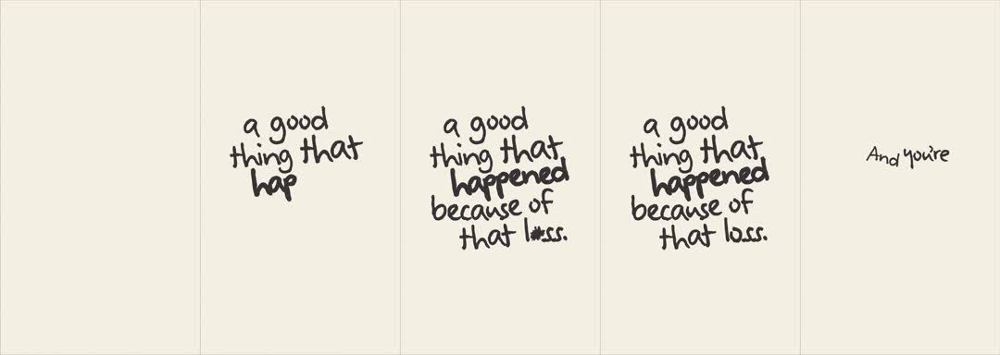

# v04_s12 · 06 Escenas solo texto · 29.0–32.8s (calidad 3)

- **Guion:** a good thing that happened because of that loss. And you're
- **Qué se ve:** Crema: 'a good / thing that / happened / because of / that loss.'
- **Diseño:** 'happened' bold; bloque centrado ~40–55 % alto, ligeramente inclinado.
- **Efectos:** Ninguno.
- **Animación:** Build-up por palabra hacia abajo.
- **Por qué aquí:** El giro positivo del método.
