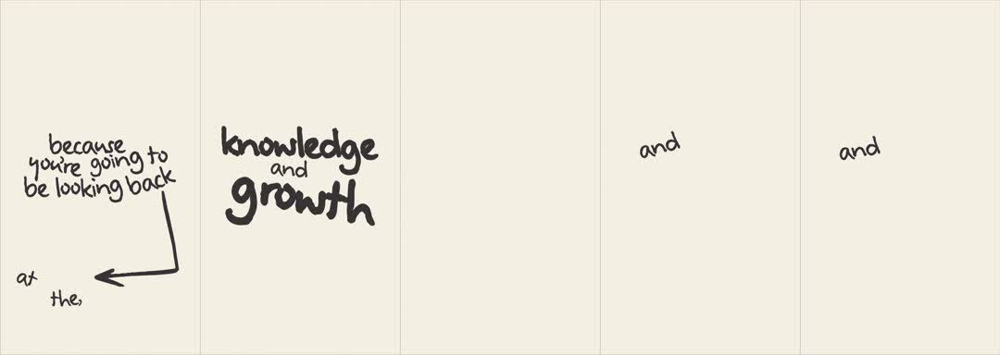

# v04_s16 · 06 Escenas solo texto · 42.5–47.5s (calidad 4)

- **Guion:** knowledge and growth from past negative experiences and the benefit
- **Qué se ve:** Crema: 'knowledge / and / growth / from' grande; luego 'negative / experien(ces)'; luego 'and' solo.
- **Diseño:** 'knowledge' y 'growth' bold muy grandes (~8 % alto) ocupando el ancho; bloque ~35–55 % alto.
- **Efectos:** Ninguno.
- **Animación:** Pop por palabra; cortes secos.
- **Por qué aquí:** La recompensa del método en las palabras más grandes hasta ahora.
