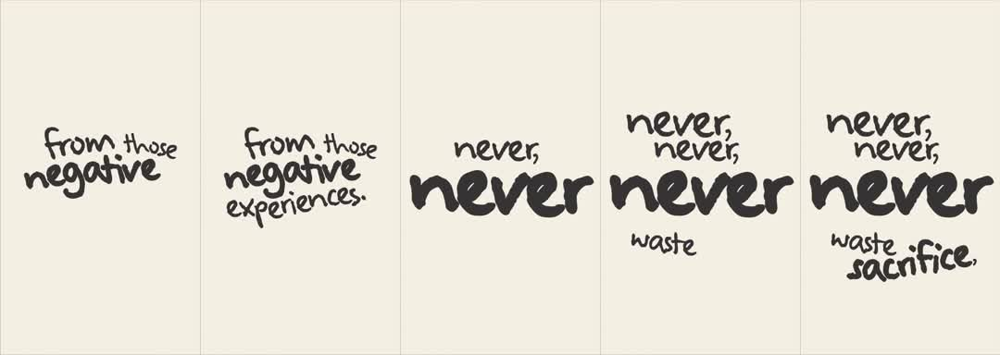

# v04_s18 · 06 Escenas solo texto · 49.0–53.0s (calidad 5)

- **Guion:** those negative experiences. Never, never, never waste sacrifice.
- **Qué se ve:** Crema: 'never' enorme a todo el ancho; luego 'never, / never, / never / waste' apilados.
- **Diseño:** 'never' extra-bold manuscrita ~12 % alto ocupando ~95 % del ancho, centrado ~50 %; las repeticiones más pequeñas arriba.
- **Efectos:** Ninguno.
- **Animación:** Pop seco por cada 'never' (≈0.1 s), escalado creciente.
- **Por qué aquí:** Clímax retórico: la triple repetición se vuelve visual (tamaño = intensidad).
