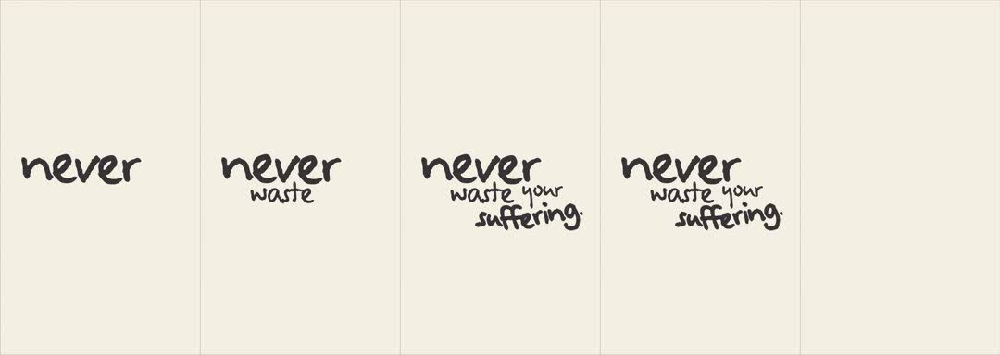

# v04_s19 · 06 Escenas solo texto · 53.0–55.0s (calidad 4)

- **Guion:** Never waste your suffering.
- **Qué se ve:** Crema: 'never' y luego 'never / waste your / suffering.' en gris medio.
- **Diseño:** Texto gris ~#8A8A8A (atenuado) centrado ~50 % alto, 'suffering.' desplazado a la derecha.
- **Efectos:** Desaturación/atenuación del texto (fade a gris).
- **Animación:** El texto se apaga a gris (≈0.5 s) como fade-out.
- **Por qué aquí:** Cierre circular con la frase del hook; el gris indica final.
