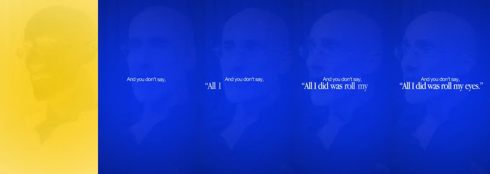

# v08_s16 · 06 Escenas solo texto · 31.8–33.8s (calidad 5)

- **Guion:** And you don't say, all I did was roll my eyes?
- **Qué se ve:** Fondo azul con la silueta/cara del speaker en doble exposición a muy baja opacidad; flashes amarillos de 1–2 frames al inicio y al final. Texto: 'And you don't say,' pequeño y la cita '“All I did was roll my eyes.”'.
- **Diseño:** Cita en serif blanca mediana con comillas curvas; 'And you don't say,' sans pequeña encima. Centro de pantalla. Azul #1E3FD8, amarillo flash #F2C230.
- **Efectos:** Doble exposición fantasma del speaker, flash de color amarillo.
- **Animación:** Flash amarillo → azul; write-on de la cita palabra a palabra (gris→blanco); flash amarillo de salida.
- **Por qué aquí:** Diálogo imaginado (lo que la persona diría): comillas + fondo de marca para separarlo de la narración; el fantasma del speaker indica que es su voz interpretando.
