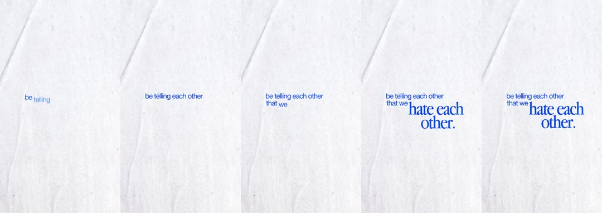

# v08_s22 · 06 Escenas solo texto · 49.2–50.6s (calidad 5)

- **Guion:** telling each other that we hate each other.
- **Qué se ve:** Fondo blanco con textura de papel arrugado; texto azul.
- **Diseño:** 'be telling each other / that we' sans pequeña azul, 'hate each / other.' serif azul grande alineada a la derecha. Azul #1E3FD8 sobre blanco #EDEDED.
- **Efectos:** Papel arrugado.
- **Animación:** Write-on por palabra; corte de azul a blanco (inversión de colores de marca).
- **Por qué aquí:** La palabra 'odio' en azul sobre blanco (inversión del sistema) cierra el bloque emocional.
