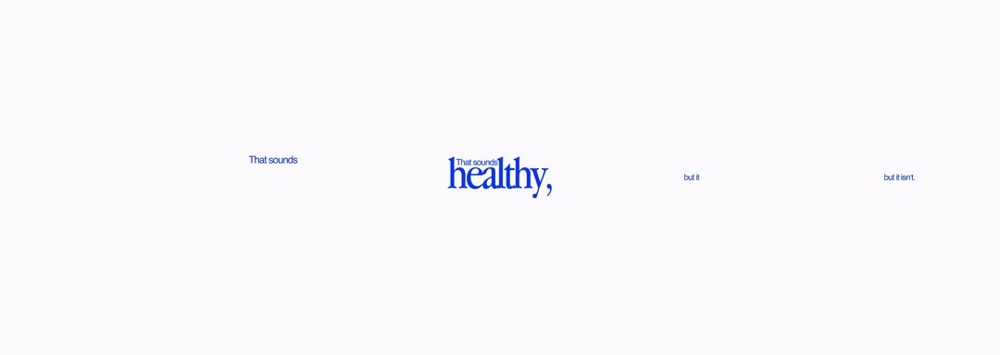

# v10_s07 · 06 Escenas solo texto · 8.6–10.0s (calidad 4)

- **Guion:** that sounds healthy, but it isn't.
- **Qué se ve:** Pantalla casi vacía blanca; solo una frase diminuta azul en el centro: 'but it isn't.'
- **Diseño:** Sans regular azul muy pequeña (~2% de la altura), centrada. Fondo #F8F7FA. Enorme espacio negativo.
- **Efectos:** Ninguno; limpieza total.
- **Animación:** Write-on por palabra, sin movimiento. Pausa visual de ~1 s.
- **Por qué aquí:** Giro del argumento: el vacío y el texto pequeño crean silencio visual y hacen que 'no lo es' pese más. Contraste con la densidad del plano anterior.
