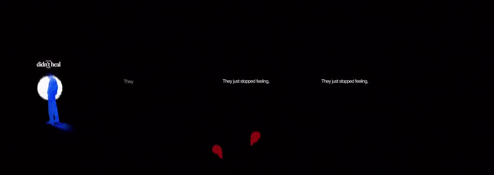

# v10_s15 · 06 Escenas solo texto · 24.0–26.1s (calidad 5)

- **Guion:** They just stopped feeling,
- **Qué se ve:** Fondo negro; 'They just stopped' pequeño (con 'stopped' en gris) y debajo una mancha roja borrosa/manchada que es la palabra 'feeling' apenas legible. Termina en negro total.
- **Diseño:** Sans pequeña blanca centrada a media altura; la palabra 'feeling' tratada como mancha roja ~#C8161D de pincel/borrón. Fondo #040104.
- **Efectos:** Blur fuerte y textura de pintura en la palabra roja, fade a negro.
- **Animación:** Write-on por palabra; 'feeling' aparece ya borrosa y se desvanece (fade-out + blur ~0.6 s) a negro absoluto durante ~0.8 s.
- **Por qué aquí:** Dejaron de sentir: la palabra 'sentir' literalmente se borra. Único uso del rojo como emoción apagándose; el negro final es silencio.
