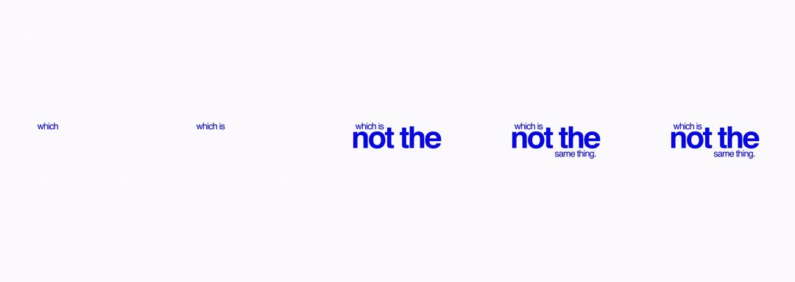

# v10_s16 · 06 Escenas solo texto · 26.1–27.3s (calidad 4)

- **Guion:** which is not the same thing.
- **Qué se ve:** Fondo blanco; 'which is' pequeño, 'not the' enorme, 'same thing.' pequeño debajo a la derecha, todo en azul.
- **Diseño:** 'not the' sans grotesca extra-bold azul #1530E0 muy grande (~45% del ancho), 'which is' y 'same thing.' sans regular azul pequeña. Bloque centrado en el tercio superior-medio.
- **Efectos:** Ninguno.
- **Animación:** Corte de negro a blanco (flash); write-on por palabra, 'not the' pop seco.
- **Por qué aquí:** Remate de la idea con contraste máximo (negro → blanco, texto pequeño → enorme). Énfasis en la negación.
