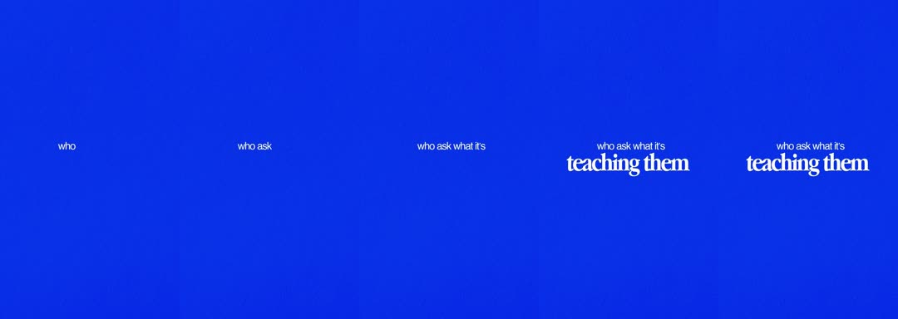

# v10_s33 · 06 Escenas solo texto · 55.5–57.2s (calidad 4)

- **Guion:** who ask what it's teaching them,
- **Qué se ve:** Fondo azul liso; 'who ask what it's' pequeño y 'teaching them' grande.
- **Diseño:** 'teaching them' serif condensada blanca, 'who ask what it's' sans pequeña encima. Tercio medio, centrado-izquierda. Azul #0B3FF5 con textura.
- **Efectos:** Textura de papel sutil.
- **Animación:** Write-on por palabra; 'teaching' y luego 'them'.
- **Por qué aquí:** Primera aparición de la idea central 'qué te está enseñando': se le da la pantalla de marca (azul) sin distracciones.
