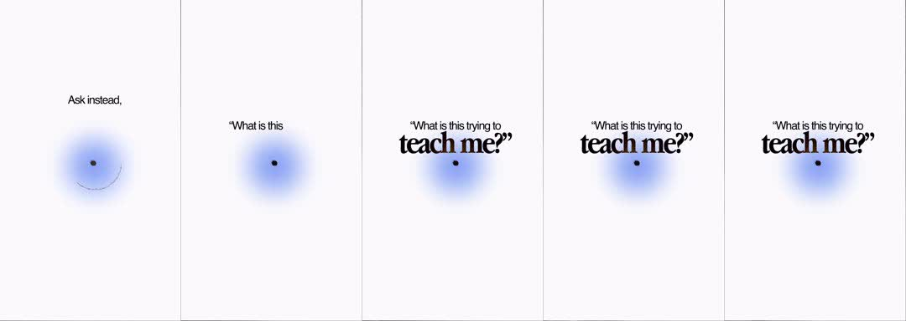

# v10_s41 · 06 Escenas solo texto · 74.5–76.7s (calidad 5)

- **Guion:** Ask instead, what is this trying to teach me?
- **Qué se ve:** Fondo blanco; la espiral se reduce a un pequeño punto con glow azul; 'Ask instead,' y luego '“What is this trying to / teach me?”' con el punto negro debajo.
- **Diseño:** 'teach me?”' serif negra condensada grande con comillas curvas; '“What is this trying to' sans pequeña negra. Centrado, tercio medio. Glow azul #5086ED bajo el punto.
- **Efectos:** Glow radial suave.
- **Animación:** La espiral se contrae y desaparece (~0.4 s) dejando el punto; 'Ask instead,' se sustituye por la cita completa, write-on por palabra.
- **Por qué aquí:** La pregunta correcta como cita destacada = idea central del video; el punto queda como 'semilla' que pasa a la siguiente escena.
