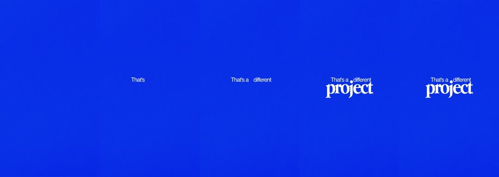

# v10_s42 · 06 Escenas solo texto · 76.7–78.2s (calidad 5)

- **Guion:** That's a different project,
- **Qué se ve:** Fondo azul; 'That's a' + punto blanco + 'different' pequeño, y 'project' grande donde el punto se convierte en el punto de la 'j'.
- **Diseño:** 'project' serif condensada blanca grande; prefijo sans pequeña. Tercio medio centrado. Azul #0B3FF5 con textura.
- **Efectos:** Textura de papel.
- **Animación:** Match-cut: el punto de la escena anterior se mantiene en la misma posición y luego cae para formar parte de 'project'. Write-on por palabra.
- **Por qué aquí:** Continuidad gráfica entre la pregunta y su consecuencia: la nueva pregunta 'es un proyecto' que nace de ese punto.
