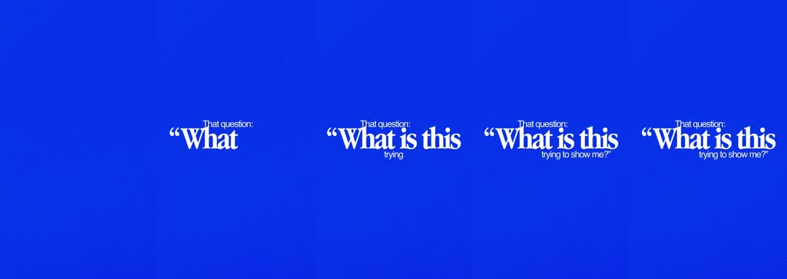

# v10_s45 · 06 Escenas solo texto · 81.7–83.7s (calidad 5)

- **Guion:** That question, what is this trying to show me,
- **Qué se ve:** Fondo azul; 'That question:' pequeño, '“What is this' gigante con comilla colgante, 'trying to show me?”' pequeño debajo a la derecha.
- **Diseño:** '“What is this' serif condensada blanca muy grande (≈90% del ancho) con comilla de apertura colgante fuera del margen; 'That question:' y 'trying to show me?”' sans pequeña blanca. Tercio medio-superior.
- **Efectos:** Textura de papel en el azul.
- **Animación:** Write-on por palabra incluso en la línea grande ('“What', 'is', 'this'), luego la línea pequeña.
- **Por qué aquí:** Repite la idea central como cita monumental: refuerzo antes del CTA.
