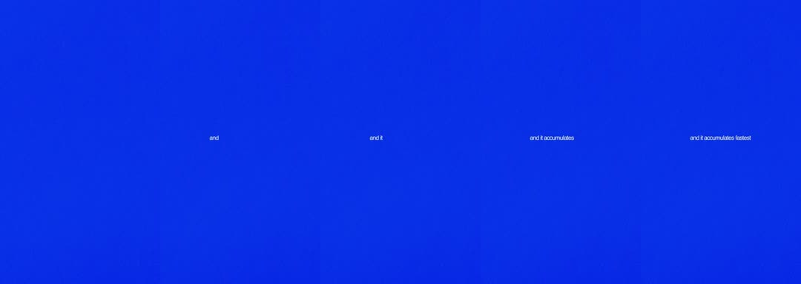

# v10_s57 · 06 Escenas solo texto · 104.0–105.6s (calidad 3)

- **Guion:** and it accumulates fastest
- **Qué se ve:** Fondo azul con texto pequeño acumulándose: 'and', 'and it', 'and it accumulates', 'and it accumulates fastest'.
- **Diseño:** Sans pequeña blanca centrada a media altura. Azul #0B3FF5 con textura.
- **Efectos:** Textura de papel.
- **Animación:** Write-on por palabra (~0.35 s/palabra), sin palabra grande: tensión que se resuelve en la siguiente escena.
- **Por qué aquí:** Construye anticipación antes del clímax visual.
