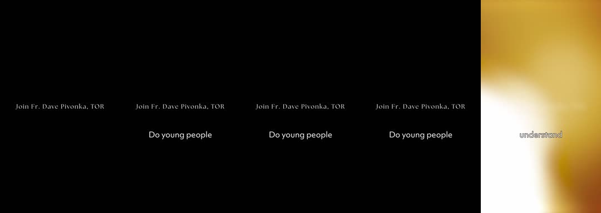

# v11_s09 · 06 Escenas solo texto · 8.8–9.7s (calidad 3)

- **Guion:** understand actually what's going on?
- **Qué se ve:** El negro pasa a blanco total; solo el caption 'understand' en gris en el centro.
- **Diseño:** Fondo blanco #FFFFFF; caption sans fina gris medio con contorno, centrado a ~63 %.
- **Efectos:** Sobreexposición a blanco (flash blanco sostenido).
- **Animación:** Fundido de negro a blanco (~0.5 s), corte seco a Brooks.
- **Por qué aquí:** Contraste negro→blanco como 'despertar' sobre la palabra 'understand' y puente hacia la respuesta de Brooks.
