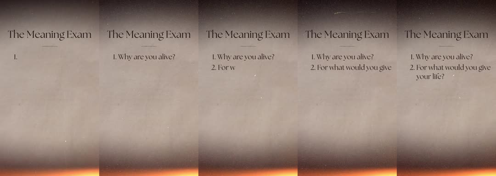

# v11_s19 · 06 Escenas solo texto · 29.6–33.8s (calidad 5)

- **Guion:** why are you alive? And the second question is, for what would you give your life?
- **Qué se ve:** Tarjeta 'The Meaning Exam' sobre papel/pergamino: título, línea divisoria corta, y lista numerada '1. Why are you alive?' / '2. For what would you give your life?' que se escribe en sincronía con la voz.
- **Diseño:** Serif fina regular (tipo Cormorant/Playfair light) gris carbón #3A3330; título ~2× la lista, centrado a ~22 % de altura; divisor fino ~15 % del ancho; lista alineada a la izquierda con sangría, ~25–32 % de altura. Fondo beige-gris #B9AFA3→#8E857B con resplandor naranja #F08A2A en el borde inferior.
- **Efectos:** Textura de papel con motas/grano, viñeta oscura en los bordes, glow cálido abajo (como brasa/fuego), polvo.
- **Animación:** Título y divisor presentes; cada ítem de la lista aparece palabra a palabra (write-on por palabra con fade ~0.1 s) siguiendo la voz. Cámara casi fija con ligero drift.
- **Por qué aquí:** Momento de valor (las dos preguntas del test): se saca del A-roll y se 'imprime' como documento para que el espectador se haga la pregunta. Lista = animación.
