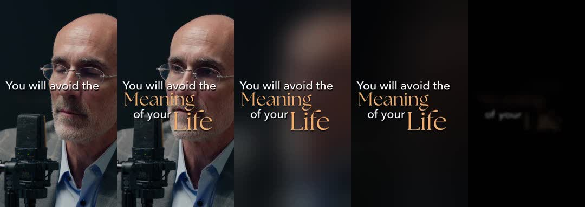

# v11_s31 · 06 Escenas solo texto · 68.9–70.3s (calidad 5)

- **Guion:** meaning of your life.
- **Qué se ve:** Se completa la frase sobre fondo oscuro degradado (la imagen de Brooks desaparece): 'You will avoid the / Meaning / of your Life'.
- **Diseño:** Mezcla sans medium blanca ('You will avoid the', 'of your') + serif ligera dorada en degradado grande ('Meaning', 'Life'); composición escalonada centrada a ~45–58 %. Fondo degradado marrón-negro #2A1C14→#0B0807.
- **Efectos:** Degradado cálido de fondo, glow suave en las palabras doradas.
- **Animación:** Fondo cambia con dissolve (~0.3 s); 'of your Life' entra al final con fade.
- **Por qué aquí:** Quote card: aísla la frase más compartible del video (pull-quote) en pantalla limpia.
