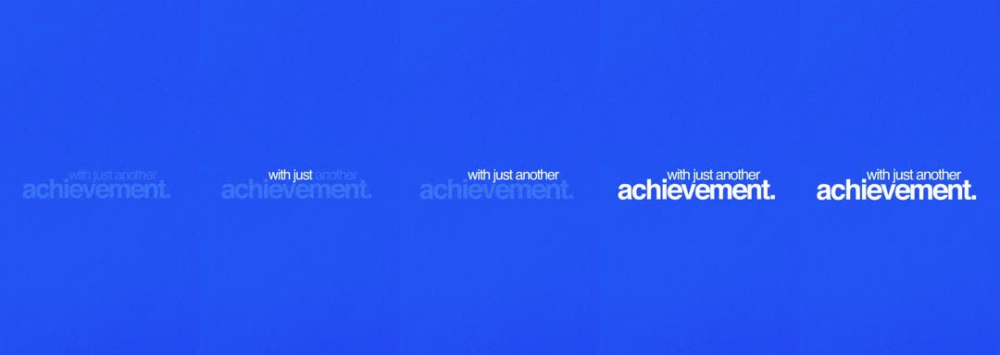

# v12_s02 · 06 Escenas solo texto · 2.0–3.7s (calidad 5)

- **Guion:** just another achievement.
- **Qué se ve:** Pantalla azul sólida con 'with just another / achievement.' en el centro.
- **Diseño:** Fondo azul eléctrico #1954F7 a sangre. 'with just another' sans regular blanca pequeña encima; 'achievement.' sans grotesca bold/heavy blanca ~3× (tipo Helvetica Now Display Bold), tracking apretado; bloque centrado a ~50 %, ligeramente a la derecha.
- **Efectos:** Textura de papel/grano muy sutil sobre el azul.
- **Animación:** Técnica 'ghost text': toda la frase ya está visible al ~15 % de opacidad (azul claro sobre azul) y cada palabra se ilumina a blanco al pronunciarse (karaoke por palabra, transición ~0.1 s). Seco y preciso.
- **Por qué aquí:** La palabra que se critica ('achievement') queda sola en un color plano: momento de pura idea, sin imagen que distraiga. El ghost-text deja anticipar la frase y crea ritmo de lectura.
