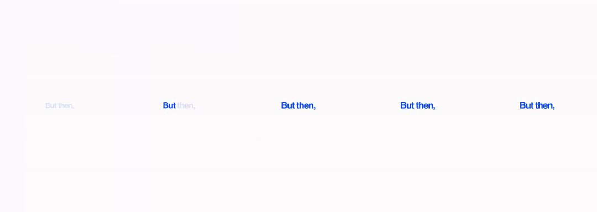

# v12_s11 · 06 Escenas solo texto · 14.1–14.9s (calidad 4)

- **Guion:** But then,
- **Qué se ve:** Pantalla blanca casi vacía con 'But then,' en azul en el centro.
- **Diseño:** Sans grotesca bold azul #0952F8, tamaño ~1.5× caption, centrada ~50 %. Fondo #FBF9F9.
- **Efectos:** Ninguno; espacio negativo máximo.
- **Animación:** Flash a blanco desde el azul (motion 51 = cambio brusco), ghost-text → 'But' → 'then,' en azul. Seco.
- **Por qué aquí:** Giro narrativo: el 'pero' se aísla en blanco para marcar el cambio de dirección (de logros a preguntas).
