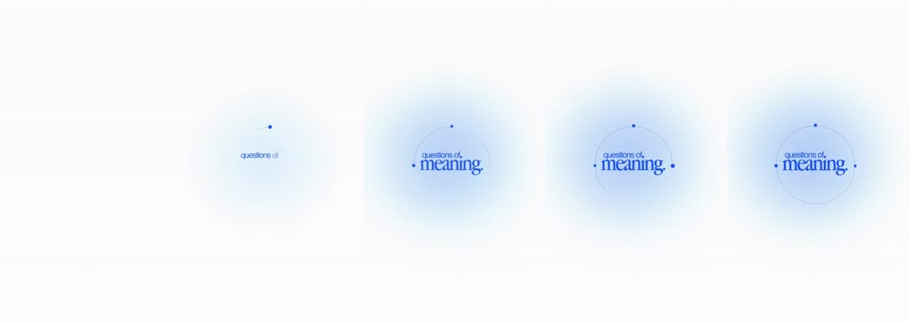

# v12_s18 · 06 Escenas solo texto · 28.4–29.8s (calidad 4)

- **Guion:** questions of meaning.
- **Qué se ve:** Fondo blanco con un halo azul difuminado circular; un punto azul orbita sobre un arco fino; texto 'questions of / meaning.'.
- **Diseño:** 'questions of' sans pequeña azul + 'meaning.' serif condensada azul ~2× centrada a ~55 %; halo radial #B0C5EE→blanco ~60 % del ancho; punto azul #1954F7 de ~2 % del ancho.
- **Efectos:** Gradiente radial azul muy suave (glow), textura de papel.
- **Animación:** El halo aparece con fade; el punto recorre un arco con estela de línea fina (~0.6 s); texto ghost→azul.
- **Por qué aquí:** Introduce la palabra clave del video ('meaning') con un elemento abstracto (punto) que se transformará en el diagrama siguiente.
