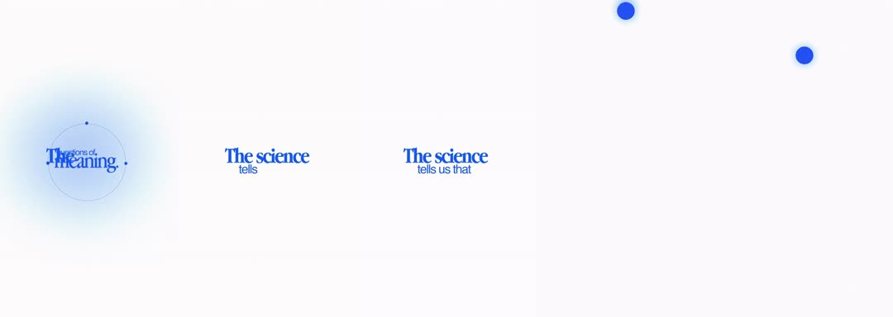

# v12_s19 · 06 Escenas solo texto · 29.8–31.6s (calidad 4)

- **Guion:** The science tells us that
- **Qué se ve:** Blanco limpio con 'The science / tells us that' azul centrado.
- **Diseño:** 'The science' serif condensada bold azul #1954F7 ~2× + 'tells us that' sans regular azul debajo, centrado ~50 %.
- **Efectos:** Papel blanco con grano mínimo.
- **Animación:** Ghost-text karaoke.
- **Por qué aquí:** Señal de autoridad ('la ciencia dice') en limpio: prepara el dato.
