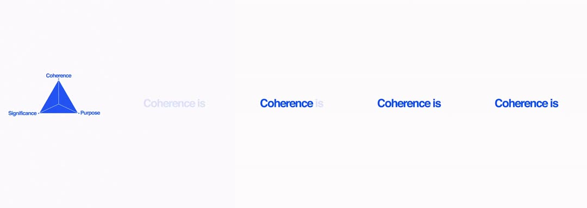

# v12_s21 · 06 Escenas solo texto · 36.2–37.3s (calidad 3)

- **Guion:** Coherence is understanding
- **Qué se ve:** Blanco con 'Coherence is' en azul grande centrado.
- **Diseño:** Sans grotesca bold azul #1954F7 ~2× caption, centrado ~50 %; 'is' en ghost.
- **Efectos:** Ninguno.
- **Animación:** Corte desde el triángulo; ghost-text karaoke.
- **Por qué aquí:** Pasa del mapa a la definición de cada parte: título de sección.
