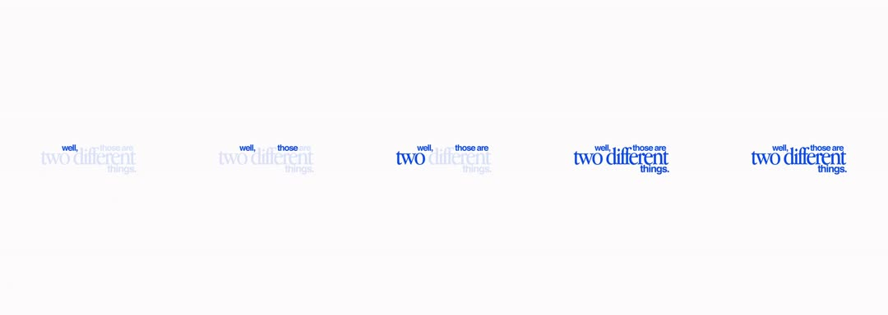

# v12_s30 · 06 Escenas solo texto · 52.4–53.8s (calidad 4)

- **Guion:** well, those are two different things.
- **Qué se ve:** Blanco con 'well, those are / two different / things.' en azul.
- **Diseño:** 'well,' 'those are' 'things.' sans bold azul pequeña; 'two different' serif condensada azul grande; bloque escalonado centrado ~50 %.
- **Efectos:** Ninguno.
- **Animación:** Ghost-text completo al 15 % → cada palabra pasa a azul pleno con la voz (karaoke exacto).
- **Por qué aquí:** Conclusión de la distinción: aislada en blanco para que se lea como aforismo.
