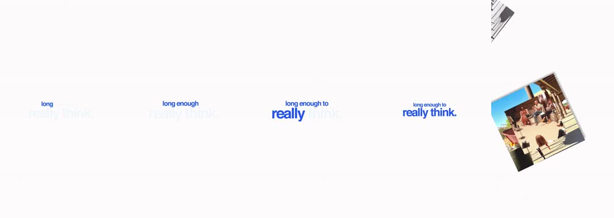

# v12_s33 · 06 Escenas solo texto · 59.2–61.3s (calidad 4)

- **Guion:** enough to really think.
- **Qué se ve:** Blanco con 'long enough to / really think.' en azul; entra rotada desde la izquierda una foto del retiro.
- **Diseño:** 'long enough to' sans pequeña + 'really think.' sans bold azul ~2×, centrado ~50 %.
- **Efectos:** Foto con sombra suave.
- **Animación:** Ghost-text karaoke; la foto entra girada ~45° desde fuera de cuadro (slide+rotate, ~0.4 s) anticipando la escena siguiente.
- **Por qué aquí:** Pausa reflexiva ('pensar de verdad') y transición física hacia el producto (el retiro).
