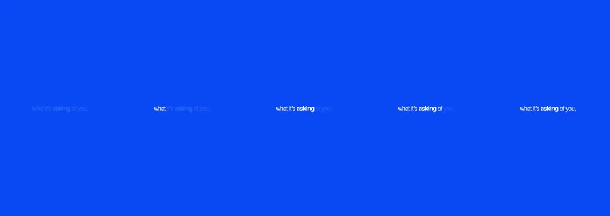

# v12_s40 · 06 Escenas solo texto · 78.7–79.8s (calidad 4)

- **Guion:** what it's asking of you,
- **Qué se ve:** Azul pleno con 'what it's asking of you,' pequeño en el centro, 'asking' en negrita.
- **Diseño:** Fondo #004BF9; sans regular blanca pequeña (~caption) con 'asking' en bold; centrado ~50 %.
- **Efectos:** Grano sutil.
- **Animación:** Ghost-text: frase al 20 % y se ilumina palabra a palabra.
- **Por qué aquí:** Frase introspectiva dirigida al espectador; tamaño pequeño = intimidad, susurro.
