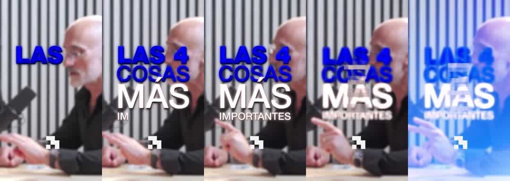

# v18_s11 · 06 Escenas solo texto · 33.4–36.6s (calidad 5)

- **Guion:** cuatro cosas más importantes son...
- **Qué se ve:** Brooks muy desenfocado al fondo; tipografía gigante 'LAS 4' azul, 'COSAS' azul, 'MÁS' blanco enorme, 'IMPORTANTES'; termina con tinte azul y flash blanco.
- **Diseño:** Sans heavy MAYÚSCULAS, ocupa ~60 % del alto; azul #1A2BE0 + blanco; alineado a la izquierda-centro.
- **Efectos:** Blur fuerte del fondo, wash azul, flash.
- **Animación:** Palabras caen en stack con pop; salida azul→blanco.
- **Por qué aquí:** Promesa de lista (cliffhanger): el clip corta antes de decir las 4 cosas → curiosidad.
