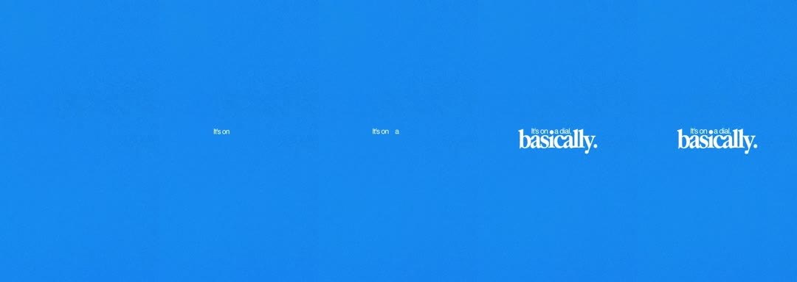

# v19_s06 · 06 Escenas solo texto · 6.3–8.0s (calidad 3)

- **Guion:** It's on a dial, basically.
- **Qué se ve:** Pantalla azul plana vacía con texto diminuto blanco 'It's on a dial' en el centro, apareciendo palabra a palabra.
- **Diseño:** Sans pequeña (~3 % altura) blanca centrada; fondo azul cielo saturado #0981F1 a sangre.
- **Efectos:** Ninguno: plano y limpio.
- **Animación:** Write-on palabra a palabra sincronizado con la voz (≈0.25 s/palabra), sin movimiento de cámara.
- **Por qué aquí:** Pausa de respiración: texto pequeño en mucho espacio negativo baja la intensidad antes del giro 'But that's wrong'.
