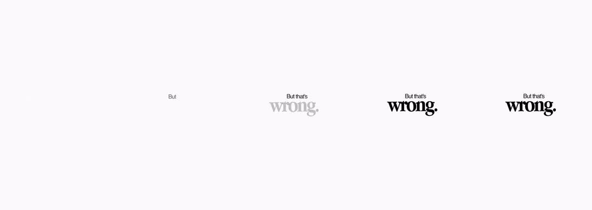

# v19_s07 · 06 Escenas solo texto · 8.0–9.1s (calidad 4)

- **Guion:** But that's wrong.
- **Qué se ve:** Fondo blanco roto; 'But that's' pequeño negro + 'wrong.' grande en gris claro.
- **Diseño:** 'wrong.' serif Didone grande gris #B7B4B8 (casi fantasma), 'But that's' sans pequeña negra encima. Centro-superior (~45 % altura). Fondo #F9F6FA.
- **Efectos:** Sin textura; contraste bajo deliberado en la palabra grande.
- **Animación:** Inversión de color azul→blanco por corte; 'wrong.' entra con blur-to-sharp y fade (≈0.3 s), suave.
- **Por qué aquí:** El giro del guion (refutación). Cambio brusco de fondo a blanco marca el 'twist' y obliga a releer la tesis.
