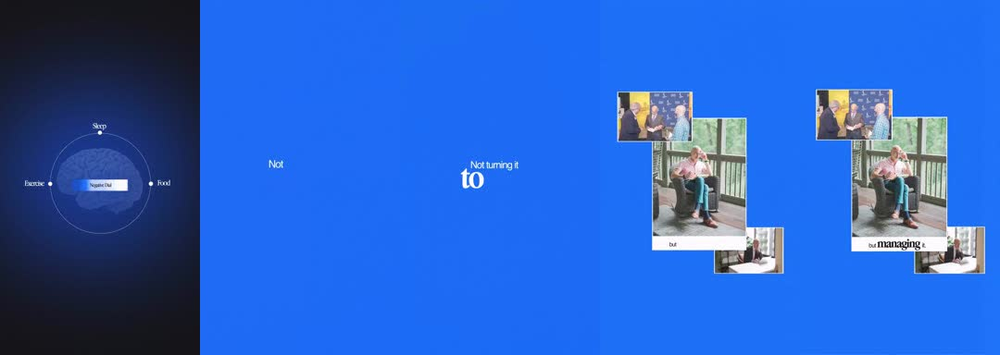

# v19_s38 · 06 Escenas solo texto · 71.9–75.7s (calidad 3)

- **Guion:** Not turning it to zero, but managing it.
- **Qué se ve:** Pantalla azul vacía (beat) y luego 'Not turning it' pequeño + 'to zero,' serif blanca grande en el centro.
- **Diseño:** Serif Didone blanca ~10 % ancho, centro; azul #126AF9.
- **Efectos:** Ninguno.
- **Animación:** Pausa de ~1 s en azul vacío; texto blur-in.
- **Por qué aquí:** Frase-matiz importante; el vacío previo la hace sonar.
