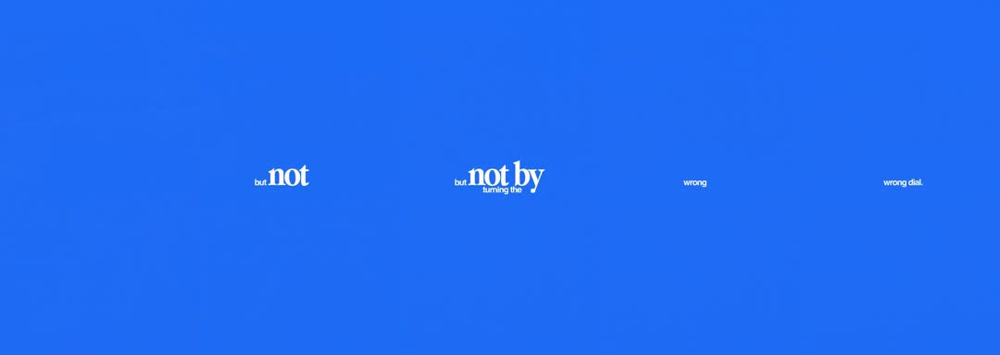

# v19_s52 · 06 Escenas solo texto · 104.2–106.0s (calidad 3)

- **Guion:** but not by turning the wrong dial.
- **Qué se ve:** Azul plano vacío y luego 'wrong dial.' diminuto centro.
- **Diseño:** Sans blanca pequeña bold; azul #0044EC.
- **Efectos:** Ninguno.
- **Animación:** Beat vacío + write-on.
- **Por qué aquí:** Cierre conceptual minimalista; deja la última idea flotando.
