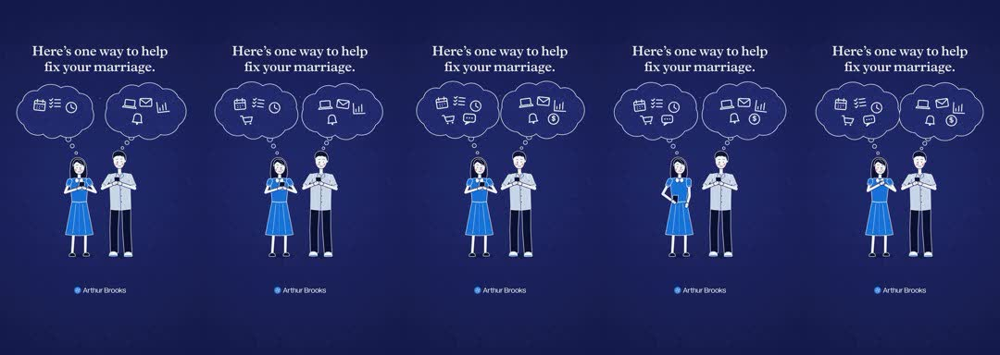

# v03_s01 · 07 Ilustración central + texto · 0.0–4.0s (calidad 4)

- **Guion:** (sin voz; solo música) Texto: 'Here's one way to help fix your marriage.'
- **Qué se ve:** Ilustración plana: pareja de pie (ella vestido azul, él camisa celeste y pantalón azul marino) mirando cada uno su móvil. Sobre cada uno, una nube de pensamiento llena de iconos lineales: calendario, checklist, reloj, carrito, chat (ella); portátil, sobre de mail, gráfico de barras, campana, moneda $ (él). Título arriba. Marca '● Arthur Brooks' abajo.
- **Diseño:** Título serif regular blanca (tipo Tiempos/Georgia), 2 líneas centradas, ~3.5 % alto, en el tercio superior (~14–19 %). Ilustración centrada (~30–75 % alto), trazo blanco fino con rellenos azul ~#2F6FE0 y celeste ~#C9D8F5. Fondo azul marino con gradiente radial ~#1F2E7A centro → #141B4D bordes. Firma sans pequeña blanca con punto azul a ~82 % alto.
- **Efectos:** Gradiente radial suave, sin textura ni grano; look flat vectorial.
- **Animación:** Iconos dentro de las nubes aparecen/rotan con pequeños pops (≈0.2 s) en bucle; figuras con micro-movimiento (respiración, móvil). Sensación suave, ritmo musical.
- **Por qué aquí:** Hook: promesa clara en el título + el problema visualizado (cada uno en su mundo mental, mirando el móvil).
