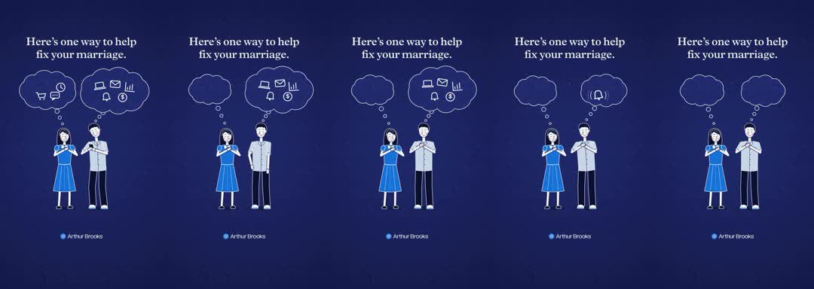

# v03_s02 · 07 Ilustración central + texto · 4.0–7.0s (calidad 4)

- **Guion:** (música)
- **Qué se ve:** Las nubes se vacían: primero la de ella (4.5 s), luego la de él (6.0 s); quedan dos nubes vacías y los dos bajan el móvil y juntan las manos en oración.
- **Diseño:** Misma composición; nubes solo con contorno blanco.
- **Efectos:** Igual: flat, gradiente radial azul.
- **Animación:** Iconos desaparecen con fade/escala hacia 0 (≈0.3 s); cambio de pose de las figuras (≈0.4 s).
- **Por qué aquí:** Transición: 'vaciar la mente' prepara el cambio de solución.
