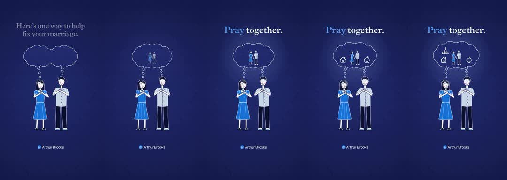

# v03_s03 · 07 Ilustración central + texto · 7.0–9.0s (calidad 5)

- **Guion:** (música) Texto: 'Pray together.'
- **Qué se ve:** El título cambia a 'Pray together.'; las dos nubes se fusionan en una sola nube compartida centrada con una casa y la pareja de la mano; halo de luz alrededor de la nube.
- **Diseño:** 'Pray' serif en azul claro ~#6FA3F0, 'together.' serif blanca, una línea ~5 % alto (más grande que el título inicial) a ~16 % alto. Nube única centrada sobre ambas cabezas.
- **Efectos:** Glow radial azul claro detrás de la nube (foco de luz).
- **Animación:** Crossfade del título; las nubes se unen con morph/escala (≈0.5 s); el glow hace fade-in.
- **Por qué aquí:** Revelación de la solución: la palabra-acción en color + una única nube = mente compartida.
