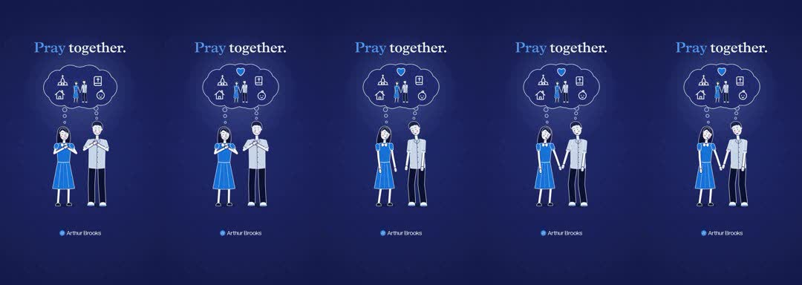

# v03_s04 · 07 Ilustración central + texto · 9.0–11.5s (calidad 5)

- **Guion:** (música)
- **Qué se ve:** La nube compartida se llena de iconos de vínculo: iglesia, corazón azul, casa, libro, anillo/reloj, pareja; las figuras se dan la mano (10.5 s).
- **Diseño:** Iconos lineales blancos con el corazón relleno azul ~#3D7BEA; composición simétrica.
- **Efectos:** Glow azul sostenido.
- **Animación:** Iconos aparecen con pop secuencial (≈0.15 s cada uno); las manos se unen con un movimiento suave.
- **Por qué aquí:** Muestra el beneficio (fe compartida, hogar, amor) sin palabras: cierre emocional.
