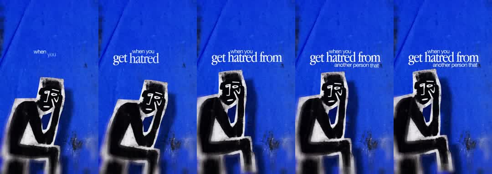

# v08_s06 · 07 Ilustración central + texto · 8.6–10.5s (calidad 5)

- **Guion:** you get hatred from another person that
- **Qué se ve:** Fondo azul con textura de papel arrugado; ilustración naíf estilo graffiti/pincel de un hombre sentado con la mano en la cara (negro con contornos blancos), como pintado en una pared.
- **Diseño:** 'when you' sans pequeña, 'get hatred from' serif condensada blanca grande, 'another person that' sans pequeña abajo-derecha; texto en el tercio superior, ilustración centrada en la mitad inferior. Azul ~#1E3FD8.
- **Efectos:** Papel arrugado, textura de pared/pintura en spray, manchas.
- **Animación:** Write-on por palabra; ilustración estática con micro-zoom.
- **Por qué aquí:** Recibir odio de alguien que amas: figura abatida dibujada a mano = vulnerabilidad, rompe con el realismo del b-roll.
