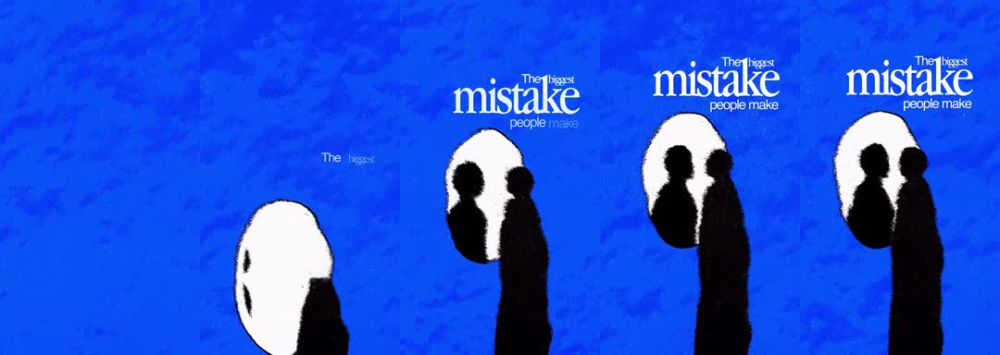

# v10_s01 · 07 Ilustración central + texto · 0.0–1.6s (calidad 5)

- **Guion:** The biggest mistake people make
- **Qué se ve:** Fondo azul eléctrico con textura de papel/acuarela. Desde abajo sube una mancha blanca orgánica (forma de huevo/cabeza) y dentro aparecen dos siluetas negras (cabeza y hombros) enfrentadas, de borde granulado. Arriba a la derecha el título: 'The' + 'biggest' pequeños, 'mistake' enorme, 'people make' debajo.
- **Diseño:** 'mistake' serif de alto contraste muy condensada y con tracking negativo (tipo Playfair Display / Editorial New compacta), blanca, ~18% del ancho de letra x-height grande; 'The' sans pequeña (Helvetica/Inter regular) y 'biggest' serif pequeña superpuestas como super-índice; 'people make' sans regular pequeña bajo la palabra grande, alineada a la derecha. Bloque de texto en tercio superior derecho; ilustración centrada-izquierda ocupando mitad inferior. Azul ~#0B3FF5 (muestras #014DFA/#003CF9), blanco #F7F6F9, negro #040104.
- **Efectos:** Textura de papel/acuarela visible en el azul (manchas suaves), borde de la mancha blanca con contorno negro irregular tipo tinta/recorte, siluetas con grano/dispersión de partículas en los bordes. Sin viñeta.
- **Animación:** 0–0.4 s fondo azul vacío; la mancha blanca entra desde abajo con escala+desplazamiento (ease-out, ~0.5 s) y las siluetas aparecen dentro; las palabras se escriben por palabra (write-on) con fade+ligero blur: 'The', 'biggest', 'mistake' (pop grande), 'people', 'make' (llega en gris y se aclara). Al final toda la composición hace slide/pan de cámara hacia la izquierda (~0.3 s) dejando el texto cortado en el borde: transición por desplazamiento al siguiente plano. Sensación suave pero decidida.
- **Por qué aquí:** Hook: anuncia 'el mayor error' con la palabra clave gigante. Sin A-roll, la ilustración de dos personas (relación/espejo de uno mismo) da identidad visual inmediata y la promesa de un error que el espectador comete.
