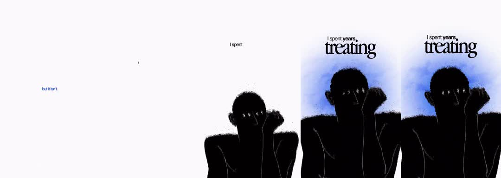

# v10_s08 · 07 Ilustración central + texto · 10.0–11.9s (calidad 5)

- **Guion:** I spent years treating
- **Qué se ve:** Fondo blanco; figura negra granulada (busto, hombros) que se tapa la cara con las manos, ojos como puntos blancos entre los dedos; contornos internos en líneas blancas finas. Tras la cabeza aparece un halo/nube azul difuminado. Texto arriba: 'I spent years' y 'treating' grande.
- **Diseño:** 'I spent' sans regular negra pequeña, 'years' sans bold; 'treating' serif condensada negra grande. Texto centrado en el tercio superior; figura ocupa mitad inferior a sangre. Azul del halo ~#5086ED difuminado.
- **Efectos:** Bordes de la silueta con grano/dispersión, glow azul difuso tipo aerógrafo detrás de la cabeza.
- **Animación:** Corte; texto 'I spent years' write-on, luego 'treating' pop; el halo azul aparece con fade+expansión (~0.4 s). Leve push-in.
- **Por qué aquí:** Confesión personal ('yo pasé años'): el narrador se pone en la escena con una figura que se esconde = vergüenza/evasión. Primera persona → personaje humano.
