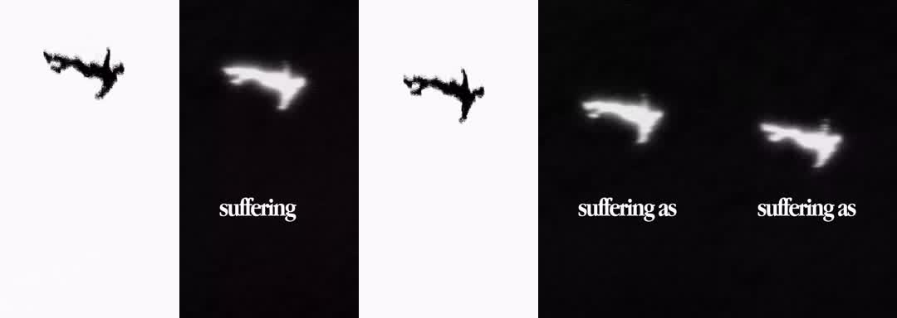

# v10_s09 · 07 Ilustración central + texto · 11.9–12.5s (calidad 4)

- **Guion:** suffering as
- **Qué se ve:** Alternancia rápida (strobe) entre: fondo blanco con figura negra granulada cayendo/flotando en horizontal, y su inverso: fondo negro con la misma figura blanca brillante y desenfocada + 'suffering' / 'suffering as' en el tercio inferior.
- **Diseño:** 'suffering as' serif condensada blanca grande en tercio inferior centrado. Blanco #F7F6F9 / negro #040104.
- **Efectos:** Inversión de color (negativo), glow/blur en la versión negra, grano.
- **Animación:** Flicker de inversión cada ~2–3 frames (0.07–0.1 s) durante ~0.6 s; el texto solo existe en la versión negra, así que parpadea. Sensación seca, de shock.
- **Por qué aquí:** Palabra cargada ('sufrimiento'): el parpadeo de negativo transmite trauma/impacto sin necesidad de imagen explícita.
