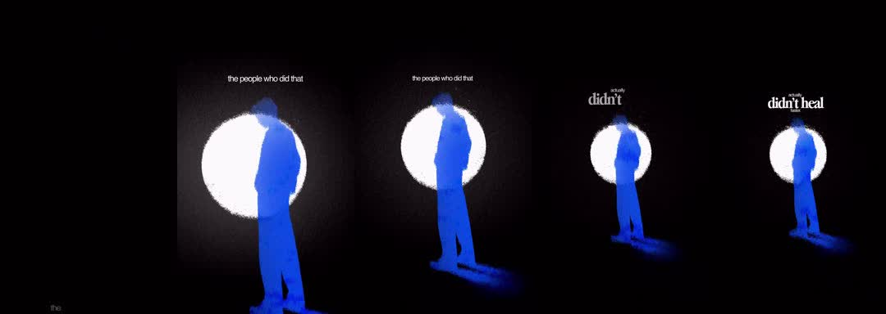

# v10_s14 · 07 Ilustración central + texto · 20.8–24.0s (calidad 5)

- **Guion:** that the people who did that actually didn't heal faster.
- **Qué se ve:** Fondo negro; un círculo blanco granulado (luna/foco) con una figura humana de pie rellena de azul brillante delante, proyectando sombra azul. Primero encuadre cerrado (figura y círculo entrando desde abajo-izquierda), luego más abierto. Textos: 'the people who did that' arriba; luego 'actually / didn't heal / faster.'
- **Diseño:** 'the people who did that' sans pequeña blanca en tercio superior; 'didn't heal' serif condensada blanca grande con 'actually' y 'faster.' diminutos arriba/abajo. Figura azul #1E3FFF con glow, círculo blanco con borde granulado.
- **Efectos:** Glow azul sobre la figura, grano en el círculo, fondo negro profundo con viñeta.
- **Animación:** Slide/zoom de cámara: la composición entra desde abajo-izquierda y se recoloca al centro (~0.5 s); después zoom-out que hace el círculo más pequeño cuando entra 'didn't heal' (~0.5 s, ease-in-out). Texto write-on.
- **Por qué aquí:** Presenta a 'las personas' como figura anónima en el foco (estudio/observación); el zoom-out al decir 'no sanaron' aleja y empequeñece = resultado decepcionante.
