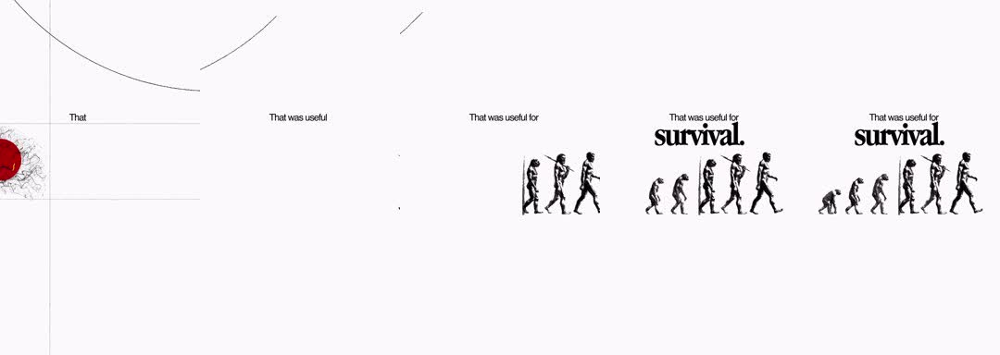

# v10_s19 · 07 Ilustración central + texto · 31.0–32.5s (calidad 4)

- **Guion:** That was useful for survival.
- **Qué se ve:** Fondo blanco con un arco fino; ilustración de la 'marcha del progreso' (evolución del simio al humano) en grabado B/N; 'That was useful for' pequeño y 'survival.' grande encima.
- **Diseño:** 'survival.' serif negra condensada pesada grande; 'That was useful for' sans pequeña. Texto centrado justo sobre la ilustración, ambos a media altura.
- **Efectos:** Ilustración de grabado/plumilla, sin color.
- **Animación:** Write-on por palabra; la fila de figuras entra deslizándose de derecha a izquierda (~0.4 s), arco que barre.
- **Por qué aquí:** 'Supervivencia' evolutiva = icono universal de evolución; lectura instantánea.
