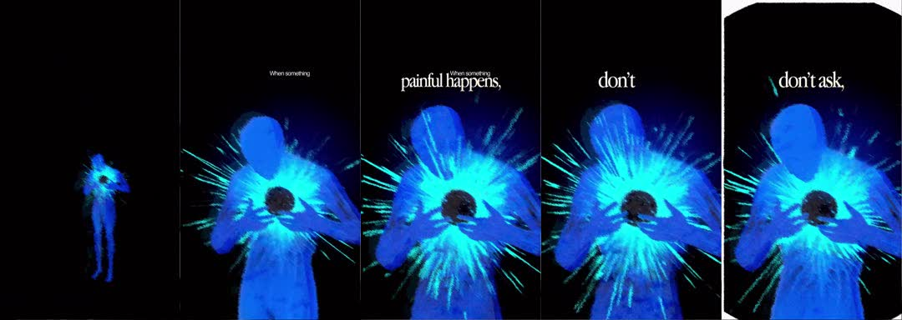

# v10_s39 · 07 Ilustración central + texto · 70.1–72.3s (calidad 5)

- **Guion:** When something painful happens, don't ask,
- **Qué se ve:** Flash blanco; fondo negro con figura humana azul brillante (tipo térmica/neón) que se agarra el pecho, con una esfera oscura en el corazón y rayos cian que estallan. Texto: 'When something' diminuto, 'painful happens,' grande; luego 'don't' y 'don't ask,'. Al final el encuadre se contrae en un círculo sobre fondo blanco y el texto pasa a negro.
- **Diseño:** 'painful happens,' serif condensada blanca grande en el tercio superior; 'don't ask,' serif blanca → negra cuando el fondo pasa a blanco. Azul #1E5BFF, cian #4FE3F0, negro.
- **Efectos:** Glow neón, rayos/partículas, aspecto de mapa térmico; máscara circular de borde granulado.
- **Animación:** Flash blanco (~0.15 s) de entrada; zoom-in sobre la figura (de cuerpo entero pequeño a plano medio) ~0.6 s; rayos animados; transición final: el frame entero se encoge en un círculo (iris-in) sobre blanco (~0.3 s).
- **Por qué aquí:** Momento de dolor físico/emocional visualizado como explosión en el pecho; el iris-in lleva al espectador hacia dentro: la pregunta interna.
