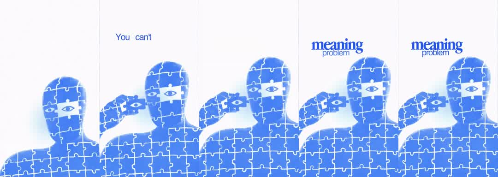

# v12_s01 · 07 Ilustración central + texto · 0.0–2.0s (calidad 5)

- **Guion:** You can't solve a meaning problem with
- **Qué se ve:** Ilustración de un busto humano azul hecho de piezas de puzzle (líneas blancas) sobre papel blanco roto; le falta la pieza del ojo y su mano sostiene esa pieza con otro ojo dibujado. Texto arriba a la izquierda: 'You can't / solve' y luego 'meaning / problem'.
- **Diseño:** Ilustración azul #4887F6/#8EB6F0 con textura, figura anclada abajo-derecha, ocupa ~60 % del alto. Tipografía en dos voces: sans grotesca regular pequeña (tipo Helvetica/Inter) para palabras funcionales ('You can't', 'problem') y serif condensada de alto contraste, tracking muy apretado (tipo Editorial New / Times condensada bold) ~3× más grande para la palabra clave ('solve', 'meaning'); ambas en azul #1954F7, bloque apilado y solapado arriba a la izquierda (~15–20 % de altura). Fondo #F9F8FB.
- **Efectos:** Textura de papel granulado en el fondo; ilustración con relleno tipo risografía/gouache; halo azul difuminado detrás de la figura.
- **Animación:** Arranca con la figura pequeña y lejos; push-in de cámara continuo (~1.3× en 2 s) mientras la mano sube la pieza a la cara. Texto: cada palabra entra con fade por palabra (karaoke) y la palabra clave grande sustituye al par anterior. Suave, ease-out.
- **Por qué aquí:** Hook-metáfora: 'problema de sentido' = persona incompleta como puzzle. La imagen dice la tesis antes de que se termine la frase; la ilustración distingue este formato del talking head.
