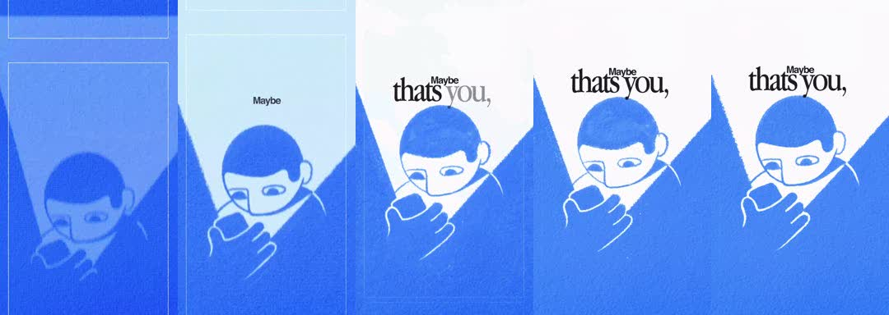

# v12_s08 · 07 Ilustración central + texto · 8.4–9.4s (calidad 5)

- **Guion:** Maybe that's you.
- **Qué se ve:** Ilustración: chico azul con flequillo mirando el móvil, iluminado por un haz de luz blanco en diagonal sobre fondo azul. Texto 'Maybe / thats you,'.
- **Diseño:** Ilustración plana azul #3B81F8 con contorno blanco a mano. 'Maybe' sans bold negra pequeña + 'thats you,' serif condensada negra grande, centrado a ~22 % de altura. Fondo mitad blanco (haz) mitad azul.
- **Efectos:** Textura de papel/grano, trazo de línea irregular tipo lápiz.
- **Animación:** Entra desde azul con marcos de líneas finas (transición de 'pantalla'), la luz se abre en abanico revelando al personaje (~0.4 s); texto karaoke.
- **Por qué aquí:** Interpelación directa ('tú'): el personaje genérico con móvil es el espectador. Pasa de b-roll real a ilustración para hacerlo personal y universal.
