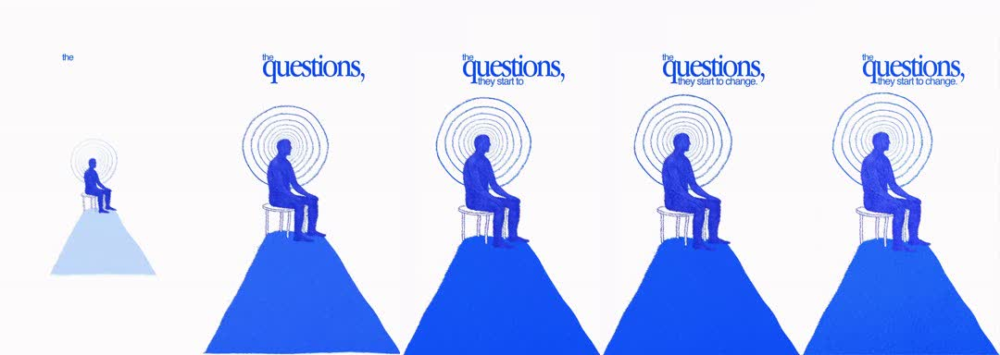

# v12_s13 · 07 Ilustración central + texto · 15.8–18.6s (calidad 5)

- **Guion:** the questions, well, they start to change. What comes next?
- **Qué se ve:** Figura azul sentada en un taburete sobre la cima de una montaña/rampa azul; detrás de su cabeza, círculos concéntricos dibujados a mano (como pensamiento). Texto 'the / questions, / they start to change.'.
- **Diseño:** Figura y montaña azul #0952F8 con textura de rotulador/cera; círculos de línea fina azul. Texto: 'the' sans pequeña + 'questions,' serif condensada azul grande + 'they start to change.' sans pequeña, arriba a la derecha ~12–15 % de altura. Fondo #FAF8F9.
- **Efectos:** Textura de papel, trazo a mano irregular, sin sombras.
- **Animación:** Empieza lejos, pequeño y desenfocado; zoom-in rápido con blur-to-sharp (~0.4 s) y luego drift lento; los círculos pulsan. Texto karaoke.
- **Por qué aquí:** 'Las preguntas cambian' = persona en la cima (ha llegado) mirando al vacío con la mente en espiral. Ilustración = estado interior.
