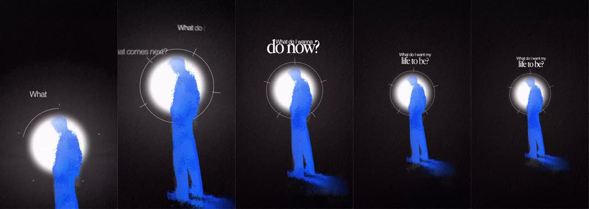

# v12_s14 · 07 Ilustración central + texto · 18.6–23.4s (calidad 5)

- **Guion:** What do I want to do now? And what do I want my life to be about right now?
- **Qué se ve:** Fondo negro texturizado; un orbe/luna blanca brillante con un anillo fino con marcas (como dial/reloj) y delante una figura humana recortada en azul eléctrico granulado, de pie, sombra azul en el suelo. Preguntas encima: 'What comes next?' → 'What do I wanna / do now?' → 'What do I want my / life to be?'.
- **Diseño:** Fondo #100B0E con textura de papel negro; figura azul #0D50F1 con textura de grano/spray; orbe blanco con glow fuerte; anillo blanco fino con 5–6 ticks. Texto blanco: sans pequeña + serif condensada grande, centrado a ~12–18 % de altura.
- **Efectos:** Glow intenso del orbe, grano, textura de spray en la figura, viñeta negra.
- **Animación:** Aparece desde negro (fade del orbe ~0.3 s); pull-out lento continuo (el conjunto se encoge ~40 % en 4 s) mientras cada pregunta reemplaza a la anterior con fade. Suave y contemplativo.
- **Por qué aquí:** Las preguntas existenciales en serie se ponen en una escena oscura, solemne, con un 'eclipse' de luz: tono introspectivo. El alejamiento da sensación de pequeñez.
