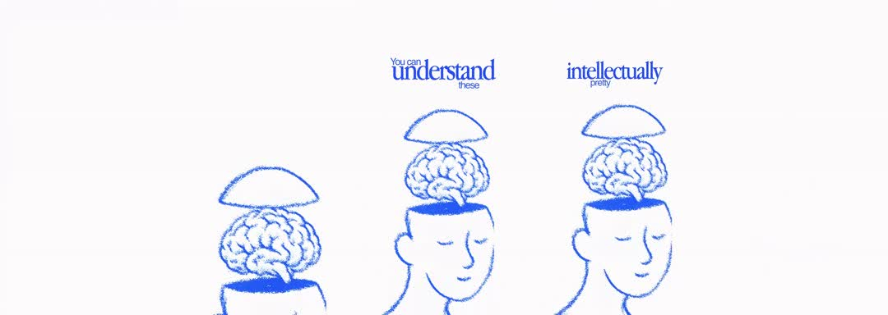

# v12_s27 · 07 Ilustración central + texto · 46.2–49.4s (calidad 5)

- **Guion:** You can understand these ideas intellectually pretty quickly,
- **Qué se ve:** Dibujo a cera azul de una cabeza con los ojos cerrados cuya tapa del cráneo se levanta y deja ver/salir el cerebro.
- **Diseño:** Trazo de cera/lápiz azul #1954F7 sobre blanco, figura abajo-centro ocupando ~60 % del alto. Texto 'You' sans pequeña arriba-izq, luego 'intellectually' serif condensada azul grande + 'pretty quickly,' sans pequeña a ~13 % de altura.
- **Efectos:** Textura de cera, papel.
- **Animación:** El dibujo sube desde abajo (slide-up ~0.4 s), la tapa se abre y el cerebro flota (animación frame a frame tipo 'boiling line'); texto karaoke.
- **Por qué aquí:** 'Entender intelectualmente' = cerebro abierto: humor visual que hace digerible la distinción.
