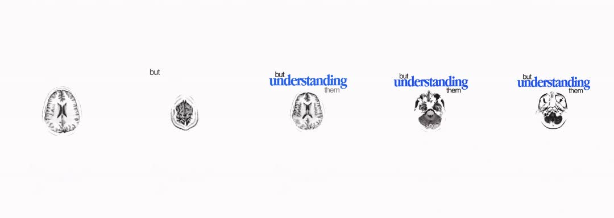

# v12_s28 · 07 Ilustración central + texto · 49.4–50.4s (calidad 4)

- **Guion:** but understanding them and
- **Qué se ve:** Imagen de resonancia/escáner cerebral en blanco y negro en el centro, con 'but / understanding / them' encima.
- **Diseño:** Escáner b/n ~25 % del ancho centrado a ~55 %; 'understanding' serif condensada azul grande + 'but'/'them' sans negra pequeña, centrado ~45 %.
- **Efectos:** Escáner con bordes difuminados.
- **Animación:** El escáner aparece con fade desde blanco; texto karaoke.
- **Por qué aquí:** Contraste: cerebro dibujado (idea) → cerebro real (entender de verdad).
