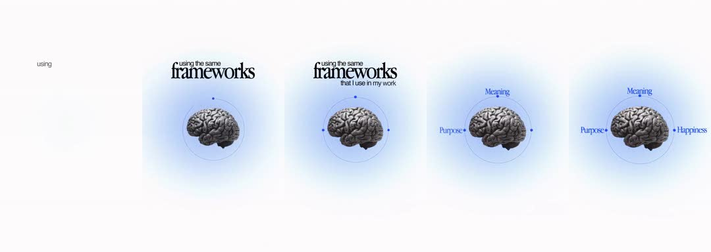

# v12_s38 · 07 Ilustración central + texto · 69.6–74.6s (calidad 5)

- **Guion:** using the same frameworks that I use in my work on meaning, purpose, and happiness.
- **Qué se ve:** Cerebro 3D gris metálico en el centro sobre halo azul difuminado; un círculo orbital fino con 3 puntos azules; aparecen etiquetas 'Meaning' (arriba), 'Purpose' (izquierda), 'Happiness' (derecha). Título 'using the same / frameworks / that I use in my work'.
- **Diseño:** Cerebro ~30 % del ancho centrado a ~55 %; órbita azul fina; etiquetas serif condensada azul pequeña; título 'frameworks' serif condensada negra grande + sans pequeña negra, a ~25 %. Fondo blanco con gradiente radial azul #B5CEF7.
- **Efectos:** Glow azul radial, render 3D con sombras suaves.
- **Animación:** El cerebro aparece con fade+scale; la órbita se dibuja y sus puntos se colocan; las 3 etiquetas entran sincronizadas con cada palabra; el título sube y se desvanece al final.
- **Por qué aquí:** Autoridad: 'mis frameworks' = objeto-icono (cerebro) + estructura (3 nodos), repite el lenguaje visual del triángulo para coherencia.
