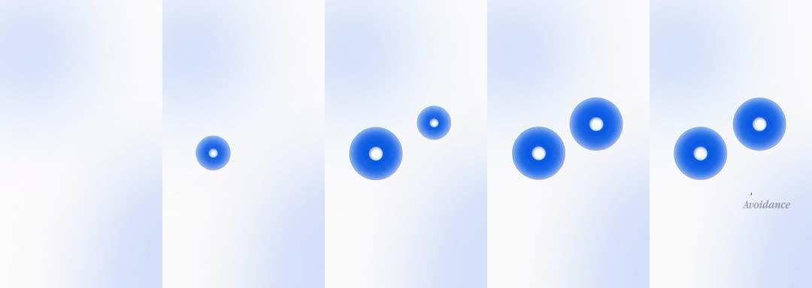

# v16_s08 · 07 Ilustración central + texto · 11.0–12.5s (calidad 4)

- **Guion:** There's two dimensions.
- **Qué se ve:** Fondo blanco con degradado lavanda/azul claro en esquinas; aparece un punto azul diminuto que crece hasta dos discos azules con degradado radial (donuts con centro blanco).
- **Diseño:** Fondo #F0F3F8 con manchas #D9E4F8 en esquinas (gradiente suave); discos azul #1E5BFF con centro blanco brillante, ~30 % ancho cada uno, en diagonal.
- **Efectos:** Degradado radial/glow suave en los discos; sin grano.
- **Animación:** Punto central hace scale-up y se divide en dos (≈0.5 s, ease-out elástico suave).
- **Por qué aquí:** 'Two dimensions' → dos objetos. Paso de A-roll a minimal para explicar un modelo.
