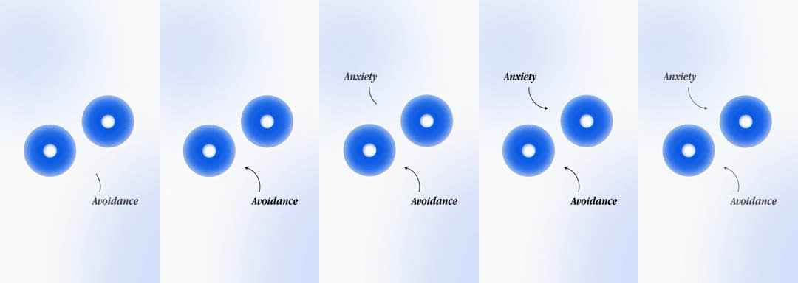

# v16_s09 · 07 Ilustración central + texto · 12.5–15.0s (calidad 4)

- **Guion:** There's avoidance and there's anxiety.
- **Qué se ve:** Los dos discos azules con etiquetas 'Anxiety' y 'Avoidance' en serif itálica negra y flechas curvas dibujadas a mano apuntando a cada disco.
- **Diseño:** Serif itálica negra pequeña (~3 % altura); flechas línea fina negra curva. Discos en diagonal (arriba-der / abajo-izq).
- **Efectos:** Plano, glow de los discos.
- **Animación:** Flechas se dibujan (stroke draw-on ≈0.3 s); etiquetas write-on; discos flotan ligeramente.
- **Por qué aquí:** Nombrar cada dimensión mientras se dice: etiquetas + flechas = diagrama de clase.
